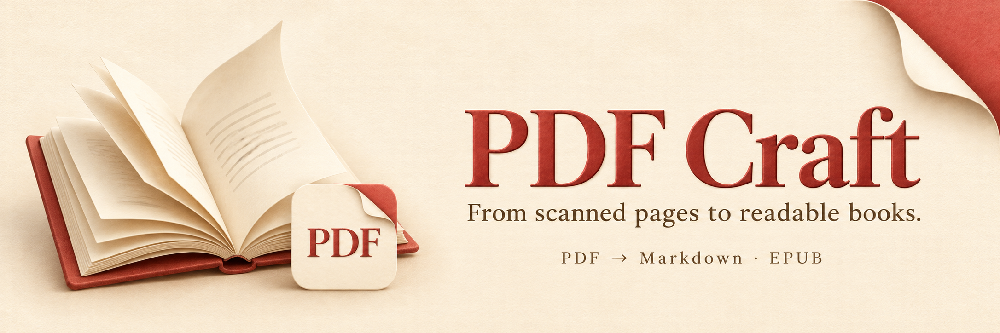
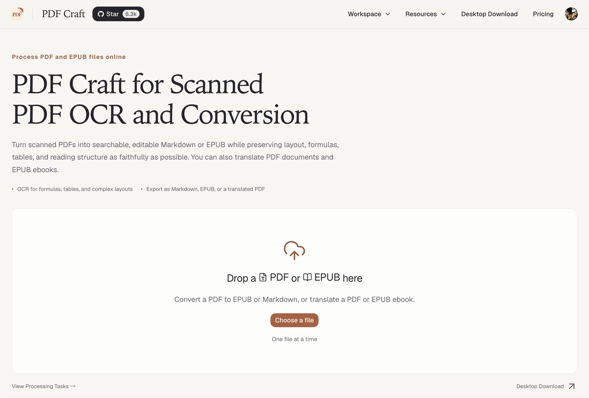
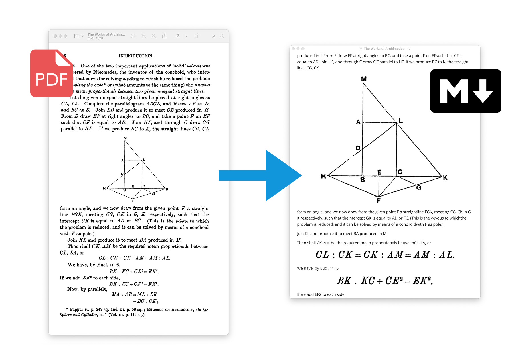
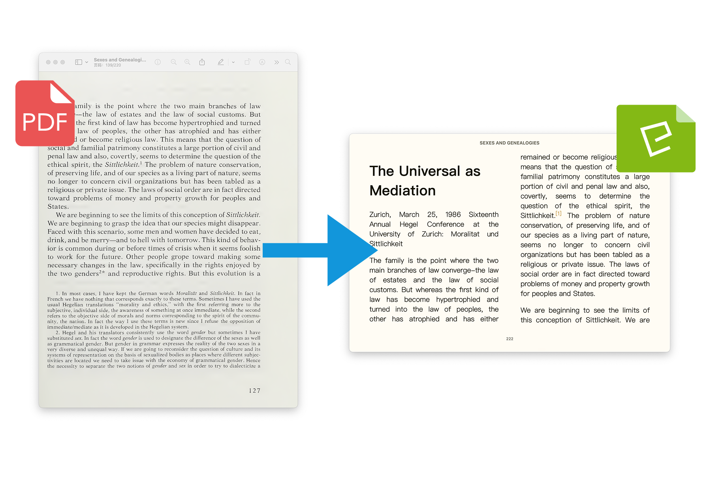

<!-- Content baseline: docs/readmes/README-zh-CN.md. Preserve the Chinese README priorities in natural local copy; keep API examples accurate. -->
<div align="center">
  
  <p><strong>English</strong> | <a href="docs/readmes/README-zh-CN.md">简体中文</a> | <a href="docs/readmes/README-zh-TW.md">繁體中文</a> | <a href="docs/readmes/README-ja.md">日本語</a> | <a href="docs/readmes/README-ko.md">한국어</a> | <a href="docs/readmes/README-ru.md">Русский</a> | <a href="docs/readmes/README-fr.md">Français</a> | <a href="docs/readmes/README-es.md">Español</a> | <a href="docs/readmes/README-de.md">Deutsch</a> | <a href="docs/readmes/README-it.md">Italiano</a></p>
  <p>
    <a href="https://pypi.org/project/pdf-craft/"></a>
    <a href="https://pypi.org/project/pdf-craft/"></a>
    <a href="https://github.com/oomol-lab/pdf-craft/actions/workflows/merge-build.yml"></a>
    <a href="LICENSE"></a>
  </p>
  <p>
    <a href="https://trendshift.io/repositories/15538"></a>
  </p>
  <p>
    <a href="https://pdfcraft.ai/pdf-craft/"><strong>Convert PDFs online</strong></a> ·
    <a href="#quick-start"><strong>Python quick start</strong></a> ·
    <a href="#documentation"><strong>Documentation</strong></a>
  </p>
</div>

PDF Craft is a Python library for scanned books, research papers, and technical documents. It converts scanned PDFs into editable Markdown or reader-friendly EPUB. It can also translate PDF and EPUB content into another language, create translated or bilingual EPUBs, and write translations back onto the original PDF pages. It recognizes body text, chapters, tables of contents, footnotes, tables, formulas, and images so the content can be searched, edited, and read beyond the scanned page.

## Convert online — no installation needed

Have a scanned PDF you want to edit or read as an ebook? Use **[PDF Craft Online · pdfcraft.ai](https://pdfcraft.ai/pdf-craft/)**: upload your file in a browser, submit a conversion task, and download the result when it is ready. There is no Python to install, no CUDA to configure, and no OCR provider or API key to set up.

PDF Craft Online is the official online service for this open-source project. Use it to convert your files directly, or use the Python library below to build conversion into your own application or run OCR on your own machine.

**[Upload your PDF and convert it online →](https://pdfcraft.ai/pdf-craft/)**

[](https://pdfcraft.ai/pdf-craft/)

## Conversion examples

**Markdown: edit, search, and process the content.**



**EPUB: read the book in an ebook reader.**



Results depend on scan quality, page layout, and the OCR model. Check a representative document before processing a larger collection.

**Want to see how your own file turns out? [Upload a PDF and convert it to Markdown or EPUB →](https://pdfcraft.ai/pdf-craft/)**

## What you can do

| Your goal | PDF Craft provides |
| --- | --- |
| Edit scanned books | PDF → Markdown, with text and image assets |
| Read in an ebook reader | PDF → EPUB, with book metadata and table of contents |
| Read books in another language | Translate during conversion or translate an existing EPUB; translation-only and bilingual output modes |
| Create a translated PDF | Translate extracted text and write it back onto the source pages |
| Integrate conversion into an app | Python APIs and reusable extraction files for later rendering or translation |

## Choose how to use it

| Path | Best for | Requirements |
| --- | --- | --- |
| **[Online conversion](https://pdfcraft.ai/pdf-craft/)** | Upload a file and download Markdown or EPUB | A browser; no Python installation or OCR service setup |
| **Python + remote OCR** | Developers who do not want to run OCR models locally | Python, Poppler, a compatible OCR service URL and credentials |
| **Python + local OCR** | Developers with their own NVIDIA GPU | Python, Poppler, CUDA, sufficient VRAM, and model files |

Remote OCR sends pages to the configured service and does not require local CUDA. Local OCR runs on your machine; using a remote LLM for translation or table-of-contents analysis still sends the corresponding content to that service.

<a id="quick-start"></a>

## Python quick start

This example uses remote OCR to convert a PDF to Markdown. Prepare **Python 3.11–3.13, Poppler, and a working DeepSeek OCR-compatible service configuration**. See the [installation guide](docs/en/INSTALLATION.md) for Poppler setup.

> Just need to convert a file without setting up a development environment or OCR service? [Use PDF Craft Online](https://pdfcraft.ai/pdf-craft/) and upload your PDF in a browser.

### 1. Install

```bash
python -m pip install pdf-craft
```

### 2. Convert a PDF

Place `input.pdf` in the directory where you run your script. Replace the URL, API key, and model name with your service configuration:

```python
from pdf_craft import DeepSeekOCRVendorConfig, PDFCraft, PDFOptions

craft = PDFCraft(
    pdf=PDFOptions(
        ocr=DeepSeekOCRVendorConfig(
            base_url="https://example.com/v1",
            api_key="your-api-key",
            model="deepseek-ocr",
        ),
    ),
)

craft.convert_pdf_to_markdown("input.pdf", "output.md")
```

Async applications use the same options through `AsyncPDFCraft`; callbacks may
also be `async def` functions and run on the caller's event loop:

```python
import asyncio
from pdf_craft import AsyncPDFCraft, DeepSeekOCRVendorConfig, PDFOptions

async def main():
    craft = AsyncPDFCraft(pdf=PDFOptions(ocr=DeepSeekOCRVendorConfig(
        base_url="https://example.com/v1",
        api_key="your-api-key",
        model="deepseek-ocr",
    )))
    await craft.convert_pdf_to_markdown("input.pdf", "output.md")

asyncio.run(main())
```

Do not call the synchronous `PDFCraft` facade from a running event loop; use
`AsyncPDFCraft` and `await` its corresponding method instead.

`https://example.com/v1` is a placeholder, not a working endpoint. Use a compatible service that actually provides the OCR model. See [OCR configuration](docs/en/OCR_BACKENDS.md) for other models. If you do not have an OCR service yet, you can convert your files with [PDF Craft Online](https://pdfcraft.ai/pdf-craft/).

Open `output.md` after conversion. Documents containing images also produce asset files; keep those files with the Markdown when moving or sharing it.

### 3. Create an EPUB

Reuse the configured `craft` instance above and replace the last line with:

```python
craft.convert_pdf_to_epub("input.pdf", "output.epub")
```

Open `output.epub` in an EPUB reader. For title, author, and rendering options, see [PDF conversion and translation](docs/en/PDF_TRANSLATION.md). For installation or runtime problems, see [troubleshooting](docs/en/TROUBLESHOOTING.md).

For EPUB bibliographic metadata, opt in to front-page OCR metadata extraction and provide a separate metadata LLM. PDF Craft accepts only values it can verify against OCR evidence. PDF file properties fill missing fields; they never override information printed in the book.

## Optional input assertions

Conversion does not automatically validate the whole input. If needed, call
`assert_pdf_readable`, `assert_pdf_renderable`, `assert_pdf_editable`, or
`assert_epub_readable` from `pdf_craft` before conversion. Choose the operation
you need: success returns `None`, failure raises the original exception, and the
input is never repaired or modified. Passing does not guarantee later OCR or
translation succeeds. See [usage and capability limits](docs/en/ERROR_HANDLING.md#optional-input-assertions).

## Translation and reusable extraction

**Translate books.** Supply an `XMLTranslator` when converting PDF to Markdown or EPUB, or translate an existing EPUB directly. Translation uses a separate text LLM; OCR and translation have independent configurations. EPUB translation can replace the original text or append the translation for bilingual reading.

**Create a translated PDF.** Extract the content, translate it, and write the translation back onto the original pages. This workflow also needs Ghostscript and suitable local fonts. Check the resulting layout against the source and translated text.

**Extract once, reuse later.** Save a `.pcex` extraction file for subsequent rendering, translation, or processing on another machine. Reuse the configured `craft` instance:

```python
craft.convert_pdf_to_markdown(
    "input.pdf",
    "output.md",
    extraction_path="book.pcex",
)
```

**Preview content as it is processed.** PDF extraction, EPUB translation, and PCEX translation/rendering support optional callbacks. Receive source-mapped paragraphs, translated EPUB fragments, final PDF layout data, and finalized book metadata before the complete output file is ready. See [incremental callbacks](docs/en/STREAMING.md).

See [PDF conversion and translation](docs/en/PDF_TRANSLATION.md), [EPUB translation](docs/en/EPUB_TRANSLATION.md), and the [`.pcex` format reference](docs/en/PCEX_FORMAT.md).

## OCR and runtime requirements

PDF Craft supports **DeepSeek OCR, DeepSeek OCR 2, and Unlimited OCR**, each with local and remote configurations.

The standard installation supports remote OCR. For local OCR, install the extra:

```bash
python -m pip install "pdf-craft[local]"
```

Local execution also requires a matching CUDA-enabled PyTorch build, sufficient VRAM, and model files. Models download from Hugging Face by default; you can also download them in advance and load them locally. Presets and requirements vary by model; see [OCR configuration](docs/en/OCR_BACKENDS.md).

**Language support depends on the processing stage.** README languages describe documentation availability. Text recognition depends on the OCR model, and translation depends on the translator and text LLM. The EPUB `label_language` parameter selects fixed navigation/default-title labels (`zh` / `en`, with English as the default and fallback); it does not restrict content or translation languages; see the [API reference](docs/en/API_REFERENCE.md).

<a id="documentation"></a>

## Documentation

| Task | Guide |
| --- | --- |
| Install system dependencies and configure a local GPU | [Installation](docs/en/INSTALLATION.md) |
| Select OCR models, remote services, or model caches | [OCR backends](docs/en/OCR_BACKENDS.md) |
| Convert PDFs, create EPUBs, or write translations into PDFs | [PDF conversion and translation](docs/en/PDF_TRANSLATION.md) |
| Translate existing EPUBs and configure bilingual output | [EPUB translation](docs/en/EPUB_TRANSLATION.md) |
| Display incremental content and source locations | [Callback guide](docs/en/STREAMING.md) |
| Look up parameters, types, and methods | [API reference](docs/en/API_REFERENCE.md) |
| Store or exchange extraction results | [`.pcex` format](docs/en/PCEX_FORMAT.md) |
| Resolve installation and conversion issues | [Troubleshooting](docs/en/TROUBLESHOOTING.md) |
| Upgrade to 2.6.0: retry and recovery policies | [Migration guide](docs/en/ERROR_HANDLING.md#upgrading-from-25x) |
| Read the 2.6.2 release notes | [Changelog](docs/changelog/v2.6.2.md) |

## Feedback and contributions

Report problems or suggest improvements through [Issues](https://github.com/oomol-lab/pdf-craft/issues). For conversion problems, include the package version, OCR configuration type, error logs, and a minimal file you can share publicly. Remove credentials and private content first.

[Pull requests](https://github.com/oomol-lab/pdf-craft/pulls) improving code, documentation, and translations are welcome. Use the Chinese README as the content baseline for all languages. Write naturally for local readers, preserving the focus on online conversion and translation capabilities, and keep API examples accurate.

If PDF Craft helps you, a Star helps others discover it.

## Related projects

[Wiki Graph](https://github.com/oomol-lab/wiki-graph) can turn converted EPUB or Markdown books into structured summaries, chapter topology, and knowledge graphs.

## License and acknowledgments

PDF Craft uses the [MIT license](LICENSE). Third-party dependencies and selected OCR models retain their own licenses.

Thanks to [DeepSeek OCR](https://github.com/deepseek-ai/DeepSeek-OCR), [DeepSeek OCR 2](https://github.com/deepseek-ai/DeepSeek-OCR-2), [Unlimited OCR](https://github.com/baidu/Unlimited-OCR), [doc-page-extractor](https://github.com/Moskize91/doc-page-extractor), [pyahocorasick](https://github.com/WojciechMula/pyahocorasick) and the open-source projects that make PDF Craft possible.

<!-- community-footer:start -->

## Contributors

Thanks to everyone who has contributed to PDF Craft. Contributions to code, documentation, and translations are welcome.

[](https://github.com/oomol-lab/pdf-craft/graphs/contributors)

## Star History

<!-- star-history:start -->
<a href="https://www.star-history.com/#oomol-lab/pdf-craft&amp;Date">
  <picture>
    <source media="(prefers-color-scheme: dark)" srcset="https://api.star-history.com/svg?repos=oomol-lab/pdf-craft&amp;type=Date&amp;theme=dark" />
    <source media="(prefers-color-scheme: light)" srcset="https://api.star-history.com/svg?repos=oomol-lab/pdf-craft&amp;type=Date" />
    
  </picture>
</a>
<!-- star-history:end -->
<!-- community-footer:end -->

Translation progress reports source words (one Han character per word, long-word cap 20), with complete pre-scanned totals and per-round updates. See [translation progress](docs/en/TRANSLATION_PROGRESS.md).
