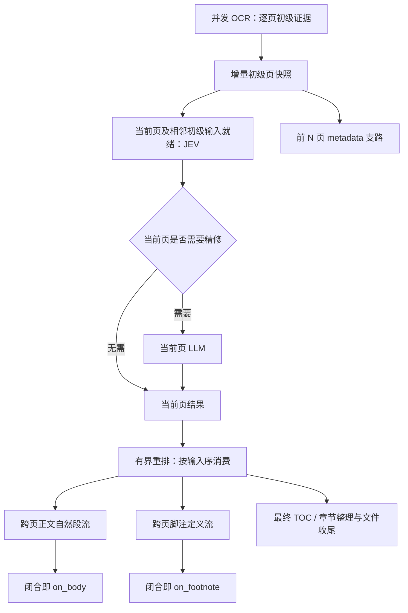

# PDF → PCEX：为什么内容必须沿管道流动

这份设计记录的是产品约束和工程取舍。它不是把一组现有函数排列成流程图：当实现与这些约束冲突时，应修实现或明确重新讨论取舍，不能把实现当前存在的全局等待解释为业务必需。

## 用户为什么传入内容回调

`on_body`、`on_footnote` 和 EPUB 翻译的 `on_body(EpubFragmentContent)`，是用户在长任务执行过程中获得内容的接口。几十秒乃至几分钟内只看到一个转圈，与逐渐出现可读文字，是不同的产品体验。进度事件回答“工作走到哪里”，内容回调回答“已经得到了什么”，前者不能替代后者。

因此，最后文件完整、最终也调用了所有回调，并不足以证明流式能力正确。内容已经具备交付条件，却被无关 metadata、目录或其他页面挡住，是行为退化。及时性必须和内容、顺序、来源身份一起验收。我们不承诺供应商的固定延迟，也不把尚未形成的半个自然段当作完整结果；承诺的是不制造无关等待。

2.6.6 曾把内容通知统一移到最终章节定稿之后。这样容易保证回调和最终 XML 一致，却取消了增量交付。2.6.7 的初级内容 hotfix 恢复了传统分析的早期通知，但没有拆掉精修的整批编排。本次管道调整进一步让页精修本身随输入推进，回调表达处理后页面形成的自然段，不再先发一份精修前预览、再发一份最终版本。

## 黑盒封装不等于全书屏障

OCR 页是不可变的证据，LLM 响应是候选。候选需要验证必要的格式、身份、页内归属以及引用位置，不能直接污染其他页。这个约束要求分清输入和候选，而不是等全书算完才能处理任何一页。

一页的确定性初级分析只读取当前 OCR 证据及必要的前部边界，建立稳定来源和初步关系。JEV 与 LLM 使用固定的初级上下文；精修改变的是另一个候选对象。某页精修先完成，不会令它以“更好”的版本替换相邻任务的初级输入。否则并发时序会改变 prompt，缓存、复现和问题定位都失去稳定基线。

`PageAnalysis` 作为内部页数据表示仍可复用。它的历史整批列表接口不是全书依赖的依据。生产链路不得为构造这个类型重新收集整本书，再进行第二轮全书传统分析。

## 每页任务只依赖自己的必要输入

JEV 的评估上下文包含当前页及存在的前后初级页。首尾没有对应邻页时使用空边界；已经落盘的缓存也经过同一输入路径。它不等待邻页精修、不等待其他 JEV。某页 JEV 判定需要 LLM 后，该页就可以提交 LLM 请求，不必等全批评分。

**LLM 只收到当前页的 JEV 评分。相邻页只提供初级内容，不显示它们的评分，即使这些评分已经准备好。** 邻页评分可能稍微改善判断，但需要让独立页任务等待其他 JEV，或使 prompt 随到达时序变化。我们主动放弃这点潜在质量收益，换取独立调度、稳定输入和更低首内容延迟。这是工程决定，不应在将来的“补充上下文”优化里悄悄恢复。

请求池仍由用户提供。JEV、LLM、OCR 各自在对应 executor 中限制实际请求；业务页的并发不创建另一套供应商额度。等待输入时也不占供应商请求槽。

## 乱序完成与有序阅读是两个层次

页面结果到达的顺序不可预测。后面的页先完成可以暂存，但自然段梳理沿输入页序前进，不能跳过缺失前页猜测连接。页级并发没有被有序阅读取消：一个慢请求不会阻止已经就绪的独立请求运行。

正文和脚注维护各自尚未闭合的单位。后继文字的 incoming continuation 决定是否连接，前页 outgoing 标记只作派生投影，不能成为另一份相互竞争的决定。图片和表格保留在段内位置；独立公式是段落边界。脚注以稳定定义身份连接，未归属的来源仍保留，不能因为没有引用标记就丢弃。

一个单位闭合就进入其通道的交付队列，不等整章或全书。正文可以先交付脚注引用的稳定身份；完整定义走脚注流，最终组装再从磁盘补齐定义。因此一个长脚注不必把无关正文留在内存等待。回调是独立快照，用户修改或持有它不会修改内部候选。通道内有序且恰好一次；两个通道没有人为规定的全局先后顺序。

## 背压是在管理资源，不是在等一批结束

无限创建页 task 会把慢页后面整本书的快照、候选和结果留在内存。管道使用一个有界的页窗口，槽位持续补充；某页消费后即可接收下一页，窗口不是必须共同完成的批次。当前实现最多八个评估/精修页任务，额外保留必要边界；OCR 准入允许十二个选中页领先，避免相邻输入饥饿，同时把压力传回生产者。

原始页、已采用页、完成的自然段、定义和通知积压落盘。内存主要容纳窗口内的输入/候选和尚未闭合的自然段或脚注；单个很长的自然段仍可能很大，不声称固定字节上限。用户回调慢时，磁盘交付队列不占供应商请求槽。START 后将被 IGNORE 的未选中页不消耗准入额度，缓存重放也遵循选页规则。可重放的 OCR 诊断缓存本身可以随书长增长，这是缓存，不是无限在途任务。

准入等待不能持有页面消费锁。否则后面待进入的页可能挡住前面仍在完成的 OCR 事件，形成死锁。结束判断必须先观察生产成功结束，再检查队列排空，不能拼接 EOF 前的空查询与 EOF 后的状态。

## 校验应放在负责它的步骤

LLM 结构、身份和页内关系在解析候选时验证；跨页连接在按序组段时验证。单页组装使用事务：若无效，不能先漏出一半内容再撤回。有限恢复先向调用者报告；拒绝恢复就传播错误，允许恢复时可采用当前页初级结果。无可信结构再进入已有的页图片/占位恢复。已接受页的磁盘记录和依赖闭包用于保护其他成果，不能因为后面坏了一页就抹掉前面所有精修。

不存在最后再批准全书候选的总关卡。任务结束仍须校验归档并原子发布；收到内容不意味着后续步骤不会失败。异常、取消、回调失败和清理都必须收敛，不能把停止生产伪装成正常 EOF，也不能为了进度到 100% 伪造成功。

## 全局整理不支配局部内容交付

TOC 可以等待标题及必要全局信息，并修改最终章节组织、标题层级和印刷目录排除。回调表达的是页面处理后的自然段，不承诺镜像这些全局整理后的 XML；不因为后处理可能修改最终组织方式而扣住所有内容，也不在最后重复回放。

Metadata 只等待它实际需要的前 N 页初级证据；PDF 原生信息可更早获取。Furniture 按页面占用和 TOC 等真实依赖生成。最终文件封装等待这些分支完成，不反过来成为正文/脚注流的前置条件。本次不重构 EPUB 的调度架构，但它采纳一个原子翻译片段就可交付的契约同样必须受保护。

## 怎样证明以后没有退回整批处理

测试用屏障固定执行顺序，而不是反复跑直到偶然通过：让后续 OCR 不结束、让邻页 JEV 阻塞、让 TOC 或 metadata 尚未完成，检查当前页 LLM 和已闭合内容确实已经产生。改变完成顺序后，初级邻页输入必须相同；故意提供邻页评分也不能进入 prompt。

另外验证窗口上限、跨页段落和定义完整性、来源顺序、恰好一次、缓存、拒绝候选的事务回滚，以及故障和取消的清理。先证明旧入口卡住，再证明新入口通过。真实付费 smoke 则验证 OCR/JEV/LLM 的实际组合与最终 PDF/PCEX/EPUB 产物；它不能替代确定性的时序证明，也不能把 fallback、内容遗漏或源码变化期间的运行计为干净通过。
