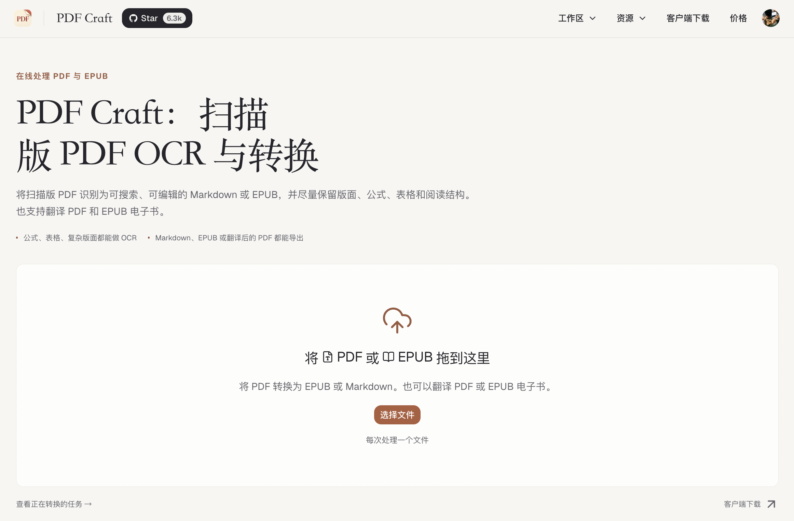
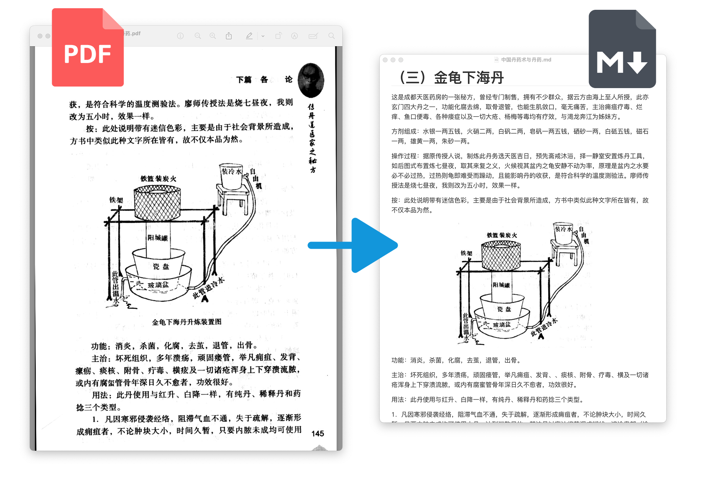
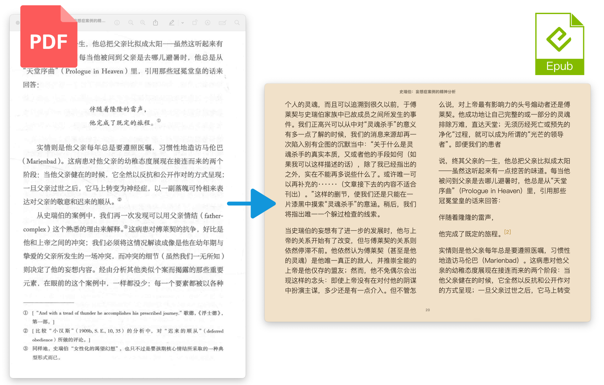

<!-- Content baseline: README-zh-CN.md. Preserve the Chinese README priorities in natural local copy; keep API examples accurate. -->
<div align="center">
  
  <p><a href="../../README.md">English</a> | <a href="README-zh-CN.md">简体中文</a> | <strong>繁體中文</strong> | <a href="README-ja.md">日本語</a> | <a href="README-ko.md">한국어</a> | <a href="README-ru.md">Русский</a> | <a href="README-fr.md">Français</a> | <a href="README-es.md">Español</a> | <a href="README-de.md">Deutsch</a> | <a href="README-it.md">Italiano</a></p>
  <p>
    <a href="https://pypi.org/project/pdf-craft/"></a>
    <a href="https://pypi.org/project/pdf-craft/"></a>
    <a href="https://github.com/oomol-lab/pdf-craft/actions/workflows/merge-build.yml"></a>
    <a href="../../LICENSE"></a>
  </p>
  <p>
    <a href="https://trendshift.io/repositories/15538"></a>
  </p>
  <p>
    <a href="https://pdfcraft.ai/pdf-craft/"><strong>線上轉換 PDF</strong></a> ·
    <a href="#quick-start"><strong>Python 快速開始</strong></a> ·
    <a href="#documentation"><strong>使用文件</strong></a>
  </p>
</div>

PDF Craft 是一個專為掃描書籍、論文與技術文件設計的 Python 函式庫，可將掃描版 PDF 轉換為方便編輯的 Markdown 或適合閱讀的 EPUB。它也能將 PDF 或 EPUB 的內容翻譯成其他語言，產生純譯文或原文與譯文對照的雙語 EPUB，並將譯文寫回原始 PDF 頁面。轉換時會辨識正文、章節、目錄、註腳、表格、公式與圖片，讓掃描頁面中的內容可以繼續搜尋、編輯與閱讀。

## 直接線上轉換，免安裝

想把手上的掃描 PDF 變成可編輯的 Markdown 或方便閱讀的 EPUB？使用 **[PDF Craft Online · pdfcraft.ai](https://pdfcraft.ai/pdf-craft/)**，在瀏覽器上傳檔案、提交轉換工作，完成後即可下載結果。不必安裝 Python、設定 CUDA，也不用自行尋找 OCR 服務或填寫 API 金鑰。

PDF Craft Online 是本開源專案的官方線上服務。處理檔案可以直接使用線上版；若要整合到自己的程式，或在本機執行 OCR，則可使用下方的 Python 函式庫。

**[上傳你的 PDF，開始線上轉換 →](https://pdfcraft.ai/pdf-craft/)**

[](https://pdfcraft.ai/pdf-craft/)

## 轉換效果

**Markdown：用於編輯、搜尋與後續內容處理。**



**EPUB：用於電子書閱讀器。**



轉換效果取決於掃描品質、頁面排版和 OCR 模型。大量處理前，請先檢查具有代表性的文件。範例截圖使用簡體中文。

**想知道自己的檔案轉換後會是什麼樣子？[上傳 PDF，線上轉換為 Markdown 或 EPUB →](https://pdfcraft.ai/pdf-craft/)**

## 你可以用它做什麼

| 你的目標 | PDF Craft 提供的能力 |
| --- | --- |
| 編輯掃描書籍 | PDF → Markdown，輸出文字與圖片資源 |
| 在電子書閱讀器中閱讀 | PDF → EPUB，支援書籍資訊與目錄 |
| 閱讀其他語言的書籍 | 轉換時翻譯，或翻譯現有 EPUB；支援僅譯文與雙語輸出 |
| 產生譯文 PDF | 翻譯擷取的文字，並寫回原始頁面 |
| 整合至自己的應用程式 | Python API，以及可重複使用的擷取結果檔案 |

## 選擇使用方式

| 方式 | 適用對象 | 需求 |
| --- | --- | --- |
| **[線上轉換](https://pdfcraft.ai/pdf-craft/)** | 直接上傳檔案，下載 Markdown 或 EPUB | 瀏覽器，免安裝 Python、免設定 OCR 服務 |
| **Python + 遠端 OCR** | 不在本機執行 OCR 模型的開發者 | Python、Poppler、相容服務的網址與憑證 |
| **Python + 本機 OCR** | 擁有 NVIDIA GPU 的開發者 | Python、Poppler、CUDA、足夠的顯示記憶體與模型檔案 |

遠端 OCR 會將頁面傳送至設定的服務，本機不需要 CUDA。本機 OCR 使用本機算力；若另用遠端 LLM 進行翻譯或目錄分析，相關內容仍會傳送至該服務。

<a id="quick-start"></a>

## Python 快速開始

此範例使用遠端 OCR 將 PDF 轉換為 Markdown。請準備 **Python 3.11–3.13、Poppler，以及可用的 DeepSeek OCR 相容服務設定**。安裝步驟見[安裝指南](../en/INSTALLATION.md)。本頁連結的詳細指南目前為英文。

> 只想轉換檔案，不想設定開發環境或 OCR 服務？[直接使用 PDF Craft Online](https://pdfcraft.ai/pdf-craft/)，在瀏覽器上傳 PDF 即可開始。

### 1. 安裝

```bash
python -m pip install pdf-craft
```

### 2. 轉換 PDF

將 `input.pdf` 放在執行指令碼的目錄中，替換服務網址、金鑰與模型名稱後執行：

```python
from pdf_craft import DeepSeekOCRVendorConfig, PDFCraft, PDFOptions

craft = PDFCraft(
    pdf=PDFOptions(
        ocr=DeepSeekOCRVendorConfig(
            base_url="https://example.com/v1",
            api_key="your-api-key",
            model="deepseek-ocr",
        ),
    ),
)

craft.convert_pdf_to_markdown("input.pdf", "output.md")
```

`https://example.com/v1` 僅為佔位網址，不能直接呼叫。請使用實際提供該 OCR 模型的相容服務。其他模型見 [OCR 設定指南](../en/OCR_BACKENDS.md)。 如果還沒有 OCR 服務，可以先透過 [PDF Craft Online](https://pdfcraft.ai/pdf-craft/) 完成檔案轉換。

完成後開啟 `output.md`。含圖片的文件也會產生資源檔案；移動或分享 Markdown 時請一併保留。

### 3. 產生 EPUB

沿用已設定的 `craft` 實例，將最後一行替換為：

```python
craft.convert_pdf_to_epub("input.pdf", "output.epub")
```

以 EPUB 閱讀器開啟 `output.epub`。書名、作者與輸出選項見 [PDF 轉換與翻譯](../en/PDF_TRANSLATION.md)；安裝或執行問題見[疑難排解](../en/TROUBLESHOOTING.md)。

若需要 EPUB 的書目資料，可選擇啟用「前頁 OCR 書目資料擷取」，並提供獨立的 metadata LLM。PDF Craft 只接受能以 OCR 頁面內容驗證的欄位；PDF 檔案屬性僅用來補足缺漏，不會覆蓋書頁印刷的資訊。

## 翻譯與擷取結果重複使用

**翻譯書籍。** PDF 轉 Markdown 或 EPUB 時可傳入 `XMLTranslator`，也可直接翻譯現有 EPUB。翻譯使用獨立的文字 LLM，與 OCR 分別設定。EPUB 翻譯可取代原文，或附加譯文供雙語閱讀。

**產生譯文 PDF。** 擷取並翻譯內容後，將譯文寫回原始頁面。此流程另需 Ghostscript 與合適的本機字型；請依原稿及譯文檢查排版。

**擷取一次，後續重複使用。** 儲存 `.pcex` 檔案，可供後續渲染、翻譯或跨機器處理。沿用已設定的 `craft` 實例：

```python
craft.convert_pdf_to_markdown(
    "input.pdf",
    "output.md",
    extraction_path="book.pcex",
)
```

詳見 [PDF 轉換與翻譯](../en/PDF_TRANSLATION.md)、[EPUB 翻譯](../en/EPUB_TRANSLATION.md)與 [`.pcex` 格式參考](../en/PCEX_FORMAT.md)。

## OCR 與執行環境需求

支援 **DeepSeek OCR、DeepSeek OCR 2 與 Unlimited OCR**，各有本機和遠端設定。遠端 OCR 使用標準安裝；本機 OCR 需安裝額外依賴：

```bash
python -m pip install "pdf-craft[local]"
```

本機執行還需要相容的 CUDA 版 PyTorch、足夠的顯示記憶體與模型檔案。模型預設從 Hugging Face 下載，也可預先下載後從本機載入。各模型的預設組態與需求見 [OCR 設定指南](../en/OCR_BACKENDS.md)。

**語言支援依處理階段而定。** README 語言表示文件可用語言；辨識取決於 OCR 模型，翻譯取決於翻譯器與文字 LLM。EPUB 的 `lan` 參數目前提供 `zh` / `en`，詳見 [API 參考](../en/API_REFERENCE.md)。

<a id="documentation"></a>

## 文件導覽

以下詳細指南為英文。

| 需求 | 指南 |
| --- | --- |
| 系統依賴與本機 GPU | [安裝](../en/INSTALLATION.md) |
| 模型、遠端服務與快取 | [OCR 設定](../en/OCR_BACKENDS.md) |
| PDF 轉換、EPUB 輸出與譯文 PDF | [PDF 轉換與翻譯](../en/PDF_TRANSLATION.md) |
| 現有 EPUB 與雙語輸出 | [EPUB 翻譯](../en/EPUB_TRANSLATION.md) |
| 參數、型別與方法 | [API 參考](../en/API_REFERENCE.md) |
| 儲存與交換擷取結果 | [`.pcex` 格式](../en/PCEX_FORMAT.md) |
| 安裝與轉換問題 | [疑難排解](../en/TROUBLESHOOTING.md) |

## 意見回饋與貢獻

歡迎透過 [Issues](https://github.com/oomol-lab/pdf-craft/issues)回報問題或提出建議。請附上套件版本、OCR 設定類型、錯誤紀錄與可公開分享的最小重現檔案，並先移除憑證和私人內容。

歡迎透過 [Pull Requests](https://github.com/oomol-lab/pdf-craft/pulls)改善程式碼、文件與翻譯。各語言版本請以簡體中文版為內容基準，以自然的在地用語傳達線上轉換與翻譯能力等重點，並保持 API 範例正確。

如果 PDF Craft 對你有幫助，歡迎給專案一顆 Star。

## 相關專案

[Wiki Graph](https://github.com/oomol-lab/wiki-graph) 可將轉換後的 EPUB 或 Markdown 書籍整理為結構化摘要、章節拓撲與知識圖譜。

## 授權與致謝

PDF Craft 採用 [MIT 授權](../../LICENSE)。第三方依賴與所選 OCR 模型各適用其自身授權。

感謝 [DeepSeek OCR](https://github.com/deepseek-ai/DeepSeek-OCR), [DeepSeek OCR 2](https://github.com/deepseek-ai/DeepSeek-OCR-2), [Unlimited OCR](https://github.com/baidu/Unlimited-OCR), [doc-page-extractor](https://github.com/Moskize91/doc-page-extractor), [pyahocorasick](https://github.com/WojciechMula/pyahocorasick) 等開源專案。

<!-- community-footer:start -->

## 貢獻者

感謝每一位為 PDF Craft 作出貢獻的人。歡迎參與程式碼、文件與翻譯的改善。

[](https://github.com/oomol-lab/pdf-craft/graphs/contributors)

## Star History

<!-- star-history:start -->
<a href="https://www.star-history.com/#oomol-lab/pdf-craft&amp;Date">
  <picture>
    <source media="(prefers-color-scheme: dark)" srcset="https://api.star-history.com/svg?repos=oomol-lab/pdf-craft&amp;type=Date&amp;theme=dark" />
    <source media="(prefers-color-scheme: light)" srcset="https://api.star-history.com/svg?repos=oomol-lab/pdf-craft&amp;type=Date" />
    
  </picture>
</a>
<!-- star-history:end -->
<!-- community-footer:end -->
